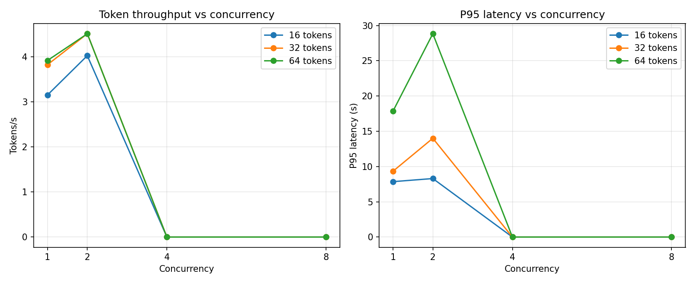

# Concurrency Extension

Extends the workload scaling study from concurrency 1-2 to 1, 2, 4 and 8.
It uses the same model, request count and trial count.
CPU-only; see the README's Limitations section.

## Results

| Max tokens | Concurrency | Req/s | Tokens/s | Mean latency (s) | P95 latency (s) | Failed |
|---|---|---|---|---|---|---|
| 16 | 1 | 0.197 | 3.156 | 5.38 | 7.86 | 0 |
| 16 | 2 | 0.252 | 4.028 | 7.07 | 8.30 | 0 |
| 16 | 4 | 0.000 | 0.000 | 0.00 | 0.00 | 45 |
| 16 | 8 | 0.000 | 0.000 | 0.00 | 0.00 | 45 |
| 32 | 1 | 0.120 | 3.828 | 8.36 | 9.34 | 0 |
| 32 | 2 | 0.141 | 4.515 | 12.67 | 14.00 | 0 |
| 32 | 4 | 0.000 | 0.000 | 0.00 | 0.00 | 45 |
| 32 | 8 | 0.000 | 0.000 | 0.00 | 0.00 | 45 |
| 64 | 1 | 0.061 | 3.922 | 16.33 | 17.87 | 0 |
| 64 | 2 | 0.071 | 4.515 | 25.42 | 28.83 | 0 |
| 64 | 4 | 0.000 | 0.000 | 0.00 | 0.00 | 45 |
| 64 | 8 | 0.000 | 0.000 | 0.00 | 0.00 | 45 |

## Scaling relative to concurrency 1

- **16 max tokens:** token throughput peaks at concurrency 2 (4.03 tok/s, 1.28x vs concurrency 1).
  At concurrency 8, mean latency is 0.00x and P95 latency is 0.00x the concurrency 1 values.
- **32 max tokens:** token throughput peaks at concurrency 2 (4.52 tok/s, 1.18x vs concurrency 1).
  At concurrency 8, mean latency is 0.00x and P95 latency is 0.00x the concurrency 1 values.
- **64 max tokens:** token throughput peaks at concurrency 2 (4.51 tok/s, 1.15x vs concurrency 1).
  At concurrency 8, mean latency is 0.00x and P95 latency is 0.00x the concurrency 1 values.

## Interpretation notes

- Flat throughput with rising latency indicates CPU saturation.
- Each configuration uses 3 trials, so small differences
  are not statistically conclusive.
- Compare only against runs on the same hardware and runtime.
