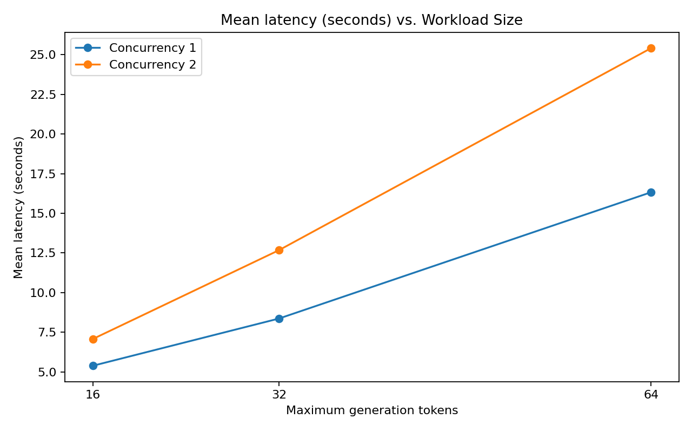
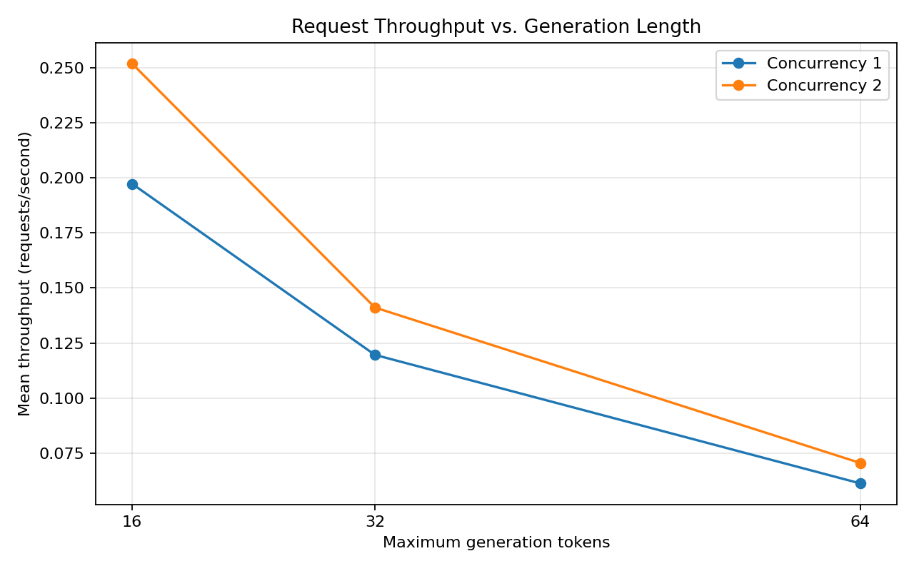
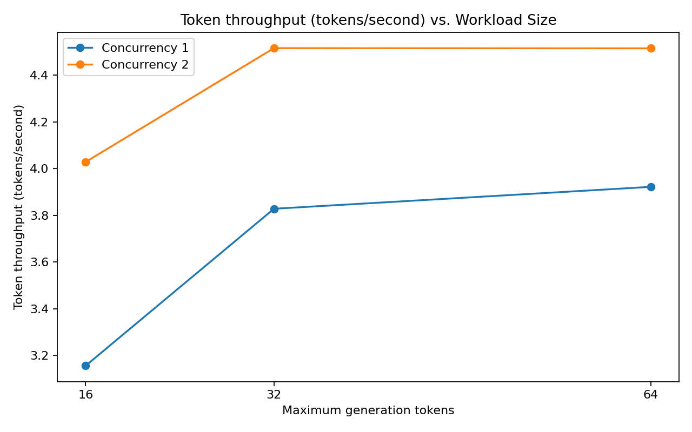

# Workload Scaling Benchmark

## Setup
- Model: Qwen2.5-0.5B-Instruct
- Runtime: Google Colab CPU
- Maximum generation tokens: 16, 32, and 64
- Concurrency: 1 and 2
- Trials: 3 per configuration
- Requests: 5 per trial

## Method
Existing raw benchmark results were consolidated by workload size and concurrency. No benchmarks were rerun to create this report.

## Results
See `workload-scaling-summary.csv` for aggregate metrics.

### Latency

### Request throughput

### Token throughput

## Interpretation
Increasing the generation-token limit increases request latency. Concurrency can improve aggregate throughput, but it may also increase per-request latency. Interpret results in the context of this CPU-only environment and the small benchmark workload.
